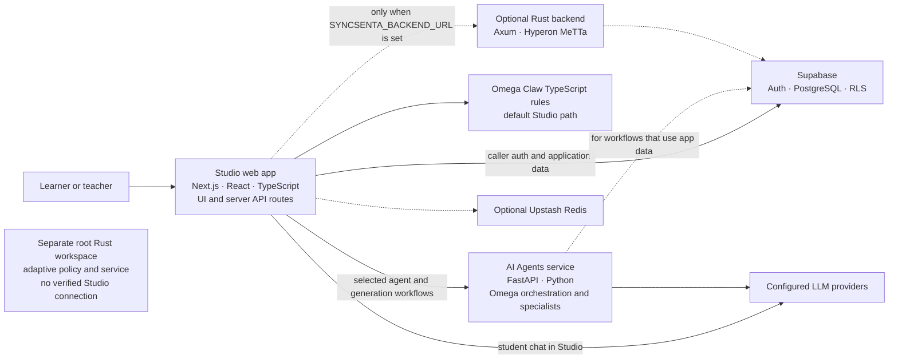
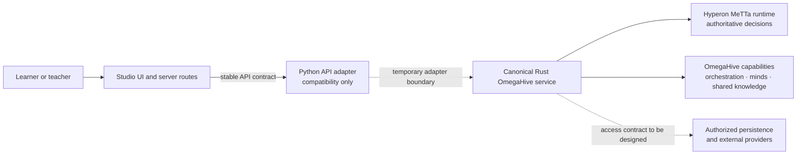

# Active architecture

This page describes the repository's active application boundaries. It does
not assert that a live deployment or database is healthy; verify the exact
target when diagnosing production behavior.

## Runtime components

| Component | Responsibility | Deployment/configuration |
|---|---|---|
| [`studio/`](../studio/) | Primary Next.js 14 / React 18 / strict TypeScript application, learner and teacher pages, and `/api/*` handlers | Vercel; configured by root [`vercel.json`](../vercel.json) |
| [`ai-agents/`](../ai-agents/) | Python 3.11 / FastAPI agent, assessment, and selected teacher-generation APIs | Render configuration in [`ai-agents/render.yaml`](../ai-agents/render.yaml) |
| [`backend/`](../backend/) | Rust / Tokio / Axum API with Hyperon MeTTa as the default Omega Claw runtime; SQLx and Redis dependencies | Render service configured in root [`render.yaml`](../render.yaml); deployment and connectivity are not verified |
| [`rust-core/`](../rust-core/) and [`rust-service/`](../rust-service/) | Separate root Rust workspace for adaptive policy and service code | Source workspace; verify deployment and integration separately |
| Supabase | Authentication, PostgreSQL, application data, and row-level security | Managed service; verify the actual target and applied schema |
| Upstash Redis | Optional rate limiting and short-lived session state | Used only by configured paths |
| Model providers | LLM integrations used by configured Studio and agent workflows | Provider and model selection varies by workflow and environment |
| [`archive/`](../archive/) | Remaining retired or experimental code retained for reference | Not part of the active request path |

These are source and configuration facts, not proof that every component is
deployed or connected in a particular environment.

## Runtime relationship diagram

The diagram distinguishes normal flows from optional or independently
configured components. Solid arrows are documented request paths; dashed
arrows are conditional or require separate deployment verification.

### Reading the diagram

- Student chat enters Studio's [`/api/chat` handler](../studio/src/app/api/chat/route.ts)
  and uses its configured provider chain; it does not automatically pass
  through the FastAPI service.
- Selected teacher-generation requests, such as exam generation, pass through
  Studio's [`/api/generate/exam` handler](../studio/src/app/api/generate/exam/route.ts)
  to the FastAPI service. The service application is
  [`server.py`](../ai-agents/src/syncsenta_agents/api/server.py).
- Omega Claw rules run in the TypeScript implementation by default. Studio
  forwards to the Rust service only when `SYNCSENTA_BACKEND_URL` is configured;
  see [`omega-claw-api.ts`](../studio/src/lib/omega-claw-api.ts).
- The root Rust workspace is distinct from the Rust backend workspace. Its
  presence does not establish a deployed service or a live Studio connection.

This view is intended to be more useful for architecture discussions and
Figma-style diagrams than a source-import graph: it shows request owners,
runtime boundaries, and which connections are conditional.

## Preliminary structure and quality assessment

This is a source-based architectural assessment, not a full code-quality audit
or deployment verification.

### Positive indicators

- The repository documents active services separately from archived code and
  distinguishes source presence from verified runtime behavior.
- Studio TypeScript strictness is enabled, and its chat request uses schema
  validation at the API boundary.
- Important service boundaries and configuration-dependent routing are
  documented in source and in this architecture reference.

### Risks and open verification

- The product spans TypeScript, Python, and two Rust workspace boundaries.
  Their presence can look like one connected backend in a repository graph even
  though only selected workflows cross those boundaries.
- Optional fallbacks and environment-controlled forwarding mean the actual
  runtime topology depends on deployment configuration.
- The Phase 2 dashboard's UI and client contract do not prove that all metric
  endpoints, authorization checks, database sources, or production schema are
  connected end to end. See the [Phase 2 roadmap](ROADMAP.md).
- A broader code-quality rating would require reviewing representative
  end-to-end flows and running the relevant checks; package manifests and
  directory structure alone are insufficient evidence.

## Specification workspace

Future product and engineering specifications for this architecture discussion
will be added below in this same document. No new feature scope is assumed by
this reference.

### Specification authoring method

Use the [`pstack-claude` architect workflow](https://github.com/michael-denyer/pstack-claude/tree/c9443218b6352fb7a2f0355b5a049ac77db063a8/plugins/pstack/skills/architect)
as a design method: trace the systems a change touches, compare plausible
design shapes, identify a single owner for each piece of state, and record
accepted deviations. The public workflow was reviewed at the linked revision;
the plugin was not installed or executed in this VS Code session.

For each specification, record:

1. **Goal and user problem** — who needs what outcome and why.
2. **Scope and non-goals** — explicit inclusions and exclusions.
3. **Current request path** — routes, services, data sources, and verified
   boundaries involved.
4. **Proposed design** — responsibilities, state ownership, interfaces, and
   alternatives considered.
5. **Trust and data boundaries** — authentication, authorization, RLS, and
   sensitive data handling.
6. **Failure and empty states** — expected behavior for unavailable or missing
   data and upstream failures.
7. **Acceptance criteria** — observable outcomes, not implementation details.
8. **Verification plan** — focused tests and separately stated deployment or
   browser checks.
9. **Open questions and evidence gaps** — decisions that still need evidence
   or owner input.

### Specifications

#### Spec 1: Rust Hyperon OmegaHive backbone

**Status:** Draft; Rust/Hyperon direction confirmed, implementation not started
**Goal:** Make a Rust service using the real Hyperon MeTTa runtime the
authoritative OmegaHive/Omega backend. Keep Studio as the product UI and reduce
Python to an API compatibility/transport layer; Python must not remain the
reasoning, orchestration, or policy authority.

##### User problem

The current project uses "Omega" for several different things: a Python
orchestrator, an optional Hyperon policy evaluator, a Rust Hyperon interpreter
focused on Omega Claw rules, and a TypeScript Omega Claw rule mirror. This does
not yet provide one clearly authoritative Hyperon-backed Omega runtime.

##### Current evidence

- Studio's student chat route currently invokes its own model-provider chain:
  [`/api/chat`](../studio/src/app/api/chat/route.ts).
- The FastAPI entry point is
  [`server.py`](../ai-agents/src/syncsenta_agents/api/server.py). It is a
  compatibility adapter for provider-backed assessment and generation routes;
  it does not own Omega routing or policy.
- The separate Rust backend has Hyperon enabled by default in
  [`Cargo.toml`](../backend/syncsenta-backend/Cargo.toml). Its
  [`MettaInterpreter`](../backend/syncsenta-backend/src/metta_core/interpreter.rs)
  wraps the Hyperon crate, and its
  [`OmegaClawRules`](../backend/syncsenta-backend/src/metta_core/omega_claw.rs)
  applies a MeTTa rule pack. This is a real Hyperon integration, but it is not
  yet the complete OmegaHive runtime. The API routes currently instantiate
  `MettaInterpreter` and `OmegaClawRules` directly rather than booting the
  assembled [`MettaCore`](../backend/syncsenta-backend/src/metta_core/mod.rs).
  The backend is not currently configured for deployment. Studio forwards Omega
  tutoring and Omega Claw decisions to this Rust/Hyperon backend only; no
  TypeScript or Python policy mirror is authoritative.
- The root
  [`rust-core` agent runtime](../rust-core/src/agent_runtime.rs) defines a
  Rust-owned orchestration seam, but its evaluator is injected; the crate does
  not itself provide the backend's Hyperon interpreter. It is not a substitute
  for the real Hyperon service.
- The Rust backend's [`KnowledgeBase`](../backend/syncsenta-backend/src/metta_core/knowledge_base.rs)
  has optional database and IPFS adapters, including a no-op IPFS default.
  Their presence does not establish durable, production-ready AtomSpace
  persistence.
- The root Rust workspace is a different workspace and is not the backend's
  Hyperon integration.
- The public
  [OmegaHive handover README](https://github.com/omega-flagship/omegahive-start-here/blob/239d03281281a1dfd7e0b2c6aa52711cf1d36693/README.md)
  describes the OmegaHive source as private and marks the handover material
  "Not yet reviewed." Its public
  [system overview](https://github.com/omega-flagship/omegahive-schematics/blob/9ff75f279ca96051cb664d7bd05004bb58834229/01-system/01-system-overview.md)
  describes a Python hive process with PeTTa/SWI-Prolog runtimes, not a Rust /
  Hyperon service.
- The private OmegaHive source could not be retrieved in this session. The
  public documentation is an architectural reference, not verified source or
  permission to copy code. Its handover README also distinguishes open and
  closed-source components.

##### Product-owner direction

- Rust is the backend and reasoning authority.
- Hyperon MeTTa is the actual runtime for Omega decisions, not a TypeScript or
  Python reimplementation presented as equivalent.
- Python remains only as an API adapter where needed for compatibility.
- OmegaHive is the target architecture reference. Its relevant concepts and
  contracts must be reviewed and selectively mapped; this spec does not assume
  its Python/PeTTa implementation can be copied into Rust.
- Studio remains the learner/teacher web UI unless a later decision changes
  that boundary.

##### OmegaHive-to-SyncSenta component map

The OmegaHive side of this comparison comes from the public,
unreviewed [system overview](https://github.com/omega-flagship/omegahive-schematics/blob/9ff75f279ca96051cb664d7bd05004bb58834229/01-system/01-system-overview.md),
[mind runtime](https://github.com/omega-flagship/omegahive-schematics/blob/9ff75f279ca96051cb664d7bd05004bb58834229/03-minds/01-mind-runtime.md),
and [MeTTa/AtomSpace overview](https://github.com/omega-flagship/omegahive-schematics/blob/9ff75f279ca96051cb664d7bd05004bb58834229/04-knowledge/01-metta-and-atomspace.md).
These documents describe the handover design; each mapping still requires
source-level review after access is granted.

| OmegaHive concept | SyncSenta evidence today | Rust/Hyperon target |
|---|---|---|
| Hive API and control plane | Axum routes exist, but the backend exposes a limited set of protected routes and an explicitly in-memory, unauthenticated MVP surface; see [`routes.rs`](../backend/syncsenta-backend/src/routes.rs) and [`mvp.rs`](../backend/syncsenta-backend/src/handlers/mvp.rs) | Make the existing Axum backend the canonical service boundary; define the supported public API and authenticated control-plane routes |
| Omega agent routing and specialists | Removed Python Omega orchestrator; Rust/Hyperon is the policy authority | Studio validates and forwards requests; Rust owns scope, progression, hints, and tutoring policy |
| Native minds and lifecycle | The public OmegaHive design describes supervised PeTTa mind processes; no equivalent production-ready Rust lifecycle has been established in this repository | Map required lifecycle and process-isolation semantics, then implement only the agreed subset in Rust |
| Hyperon / AtomSpace reasoning | Rust `MettaInterpreter` provides real Hyperon spaces; Rust rule packs and the TypeScript chat policy are narrower than a general OmegaHive mind runtime | Hyperon is the authoritative reasoning engine; define typed Rust adapters for domain facts, queries, decisions, and failures |
| Shared commons and persistence | `MettaSpace` is in-memory; `KnowledgeBase` can optionally take a PostgreSQL pool, while IPFS defaults to `NullIpfs`; API wiring and persistence guarantees are not yet established | Design durable, authorized state explicitly. Do not equate an AtomSpace with persisted or RLS-protected application records |
| Policy and authorization | Rust JWT middleware validates service tokens and attaches role claims; Python has a separate evaluator; Studio uses Supabase caller sessions | Keep identity/authentication at trusted boundaries and make Rust the policy decision authority. Hyperon policy must not replace authentication or RLS |
| Model gateway | Studio and Python have provider paths; the inspected Rust backend has an HTTP client dependency but no verified central model gateway path | Centralize model-provider calls behind Rust-owned budgets, credentials, timeouts, and audit-safe telemetry if the OmegaHive source review confirms those requirements |
| Programs/apps host | No matching active SyncSenta contract was established in this review | Defer unless a selected SyncSenta workflow requires it |
| Python API layer | FastAPI currently initializes an orchestrator and exposes agent and generation endpoints | Preserve only stable API compatibility, validation, and forwarding; no policy, orchestration, state ownership, or model reasoning |

##### Proposed request path

The diagram below is the intended target, not a claim about the current
deployment. Dotted lines indicate transitional or undecided boundaries.

##### Design options

1. **Extend the existing Rust backend.** Make
   [`backend/`](../backend/) the single canonical Rust runtime, then migrate
   orchestration, policy, and agent responsibilities into it. Keep the Python
   service as a thin adapter while callers move. This reuses the repository's
   existing Axum and default-Hyperon integration and avoids introducing a third
   Rust service boundary.
2. **Create a new OmegaHive Rust service.** Build a separate Rust service and
   later retire or repurpose the current backend. This gives a clean conceptual
   start but duplicates the existing Rust/Hyperon boundary during migration and
   requires a separate deployment and data-access design.

**Recommended starting point:** Option 1, subject to the OmegaHive source and
license review. It is the smallest coherent path in this repository because
the current Rust backend already has an Axum API and default Hyperon feature.
This recommendation does not claim that its existing Omega Claw rule façade
is already the OmegaHive runtime.

##### Migration principles

- Preserve one authoritative owner for each decision, state store, and agent
  lifecycle.
- Treat the existing TypeScript rules and Python fallback as transitional
  compatibility paths. They must not silently remain authoritative after the
  corresponding Rust/Hyperon path is enabled.
- Migrate one observable workflow at a time behind an explicit route or
  configuration boundary. Verify request/response parity and failure behavior
  before moving the next caller.
- Keep authorization derived from the signed-in user and preserve Supabase RLS;
  never elevate learner-facing reads merely to simplify the Rust migration.
- Port OmegaHive contracts and semantics only after access and source-tier
  review. Do not copy closed-tier code or treat unreviewed handover diagrams as
  verified behavior.

##### Migration increments

1. **Access and baseline.** Obtain authorized OmegaHive source access; check
   component licenses/tiers; compare the source with the public schematics;
   record current Studio, Python, and Rust request contracts. Do not copy code
   in this increment.
2. **Rust runtime spine.** Choose the existing backend as the canonical
   service, wire a single initialized Rust Omega/Hyperon state into its
   authenticated routes, and make Hyperon startup or policy-load failures
   explicit. Prove the default build is using Hyperon rather than a fallback.
3. **First learner workflow.** Move one end-to-end student tutoring decision
   through the Rust Hyperon authority while preserving the authenticated
   caller, learning context, streaming/API contract, persistence, safety
   refusals, and truthful errors. The Studio `/api/chat` path must actually
   reach this runtime; migrating only the separate `/agents/chat` endpoint
   would not make Omega the learner-facing backbone.
4. **API compatibility migration.** Reduce Python agent endpoints to validated
   forwarding and move the remaining specialist routing and teacher workflows
   to Rust one contract at a time.
5. **Hive capabilities and retirement.** Add only the reviewed OmegaHive
   capabilities needed by SyncSenta. After all callers and tests have moved,
   retire TypeScript/Python decision mirrors and transitional forwarding paths.

Each increment requires a named owner, an observable acceptance check, and a
rollback path. Do not combine the runtime spine, all agent migrations, and
OmegaHive feature adoption into one release.

##### First vertical slice contract: learner chat

The first slice must connect the learner's real Studio chat path to Rust. Moving
only the separate FastAPI `/agents/chat` route would leave the current student
tutor outside the Omega backbone.

**Current public behavior**

- Studio validates message, history, grade, subject, language, mode,
  competency, and hint inputs in
  [`/api/chat`](../studio/src/app/api/chat/route.ts).
- Studio authenticates the caller through Supabase, reads the caller's profile
  and learning progress, applies rate limits, and uses caller-aware Supabase
  access for learner data.
- Studio currently makes the tutoring decision and builds the prompt, then
  calls a configured model provider directly.
- The response is an SSE stream with `delta` events and `[DONE]`. It may also
  emit a teacher-alert event. Stream errors and pre-stream JSON errors have
  different representations.
- After generation, the route updates chat history, activity, learning
  progress, mastery points, Omega telemetry, and API usage. Those writes have
  distinct failure and authorization behavior that must be inventoried before
  moving ownership.
- The separate FastAPI `/agents/chat` request accepts `user_id` and `role`
  fields in its JSON body and returns JSON. Those body values are not proof of
  the signed-in caller and must not become trusted authorization claims in the
  Rust service.

**Target ownership**

| Responsibility | Target owner |
|---|---|
| Learner UI and browser-facing compatibility | Studio |
| Supabase session validation and caller-scoped reads/writes during the first migration slice | Existing Studio server boundary, unless a separately reviewed Rust/Supabase auth design replaces it |
| Public Python endpoint compatibility | FastAPI handler only; validate envelope and forward without making Omega or model decisions |
| Student-turn safety/policy decision, agent selection, prompt/context assembly, Hyperon evaluation, and model call | Canonical Rust service |
| Authentication identity | Derived from a verified credential or trusted server-to-server assertion, never from client-provided `user_id` or `role` |
| Durable learner data and RLS | Existing Supabase policies and caller-aware access remain authoritative; Rust must not bypass them with service-role access |

This ownership split is the minimum safe interpretation of "Python is only the
API handler." If the product owner intends Rust to own Supabase access and all
post-turn persistence as well, specify that as a later migration after the
identity and RLS design is reviewed.

**Candidate internal request shape**

The Rust API receives a validated, bounded turn envelope. It must not receive
browser-supplied identity as authority.

| Field | Source and constraint |
|---|---|
| `request_id` | Server-generated correlation ID |
| `session_id` | Optional UUID; Studio verifies it belongs to the authenticated caller before forwarding |
| `message` | Required user text; current Studio limit is 2,000 characters |
| `history` | At most 80 entries (40 turns), each with role `user` or `assistant` and content of at most 4,000 characters |
| `grade`, `subject`, `language`, `mode` | Current Studio limits are 40 characters for grade and 80 for subject; language is `english`, `kiswahili`, or `mixed`; mode is `socratic` or `compass` |
| `competency` | Optional code/name pair with explicit no-history behavior when unmatched |
| `learning_state` | Minimal server-read signals needed by policy, such as answered/correct counts, hints, and consecutive incorrect answers; client `hintsUsed` is currently capped at 20 and combined with stored hints using the greater value |
| `teacher_context` | Optional, at most 20,000 characters, permitted only for the authorized compass mode |
| `principal` | Derived from verified auth context outside the JSON body; never copied from client claims |

The exact wire encoding and whether the caller assertion is a forwarded
Supabase token, a signed internal assertion, or a Rust-validated credential
remain architecture decisions. Do not ship until one option is selected and
tested against RLS.

**Response and stream contract**

- Preserve the current learner-visible SSE event types (`delta`, completion,
  teacher alert, and stream error) unless a versioned client contract explicitly
  changes them.
- Decide and test the ordering of completion and teacher-alert events. The
  current handler emits `[DONE]` before post-stream telemetry and may enqueue a
  teacher-alert event afterward; clients and the Rust stream must not rely on
  undocumented ordering.
- Keep pre-stream errors as appropriate HTTP status plus JSON, and mid-stream
  failures as an explicit SSE error event. Never turn a failed Hyperon or model
  call into an empty or successful answer.
- Carry session and rate-limit metadata through the adapter without exposing
  provider credentials or internal stack traces.

**First-slice acceptance**

- An authenticated Studio learner chat turn reaches the Rust service, and a
  production decision is executed by the real Hyperon runtime.
- The Rust process reports Hyperon initialization, loaded policy/rule versions,
  and failure state accurately; it does not fall back silently to Python or
  TypeScript.
- A denied or review-required policy result causes no model-provider call.
- The Python adapter has no policy evaluator, specialist selection, prompt
  policy, or direct model call on this route.
- Caller identity cannot be overridden through `user_id`, `student_id`, or
  `role` fields in the request body.
- Existing cookie auth, rate limits, RLS-scoped learning-context reads,
  persistence, streaming behavior, safety refusals, and truthful error states
  have focused regression tests.
- Parallel turns cannot lose learning-progress increments or duplicate
  idempotent side effects.
- The learner-chat route fails visibly when the Rust Hyperon service is
  unavailable; any temporary fallback is explicit, observable, and disabled
  for production.

##### Scope

**In scope**

- Define the Rust service as the future owner of Omega orchestration and
  Hyperon-backed decisions.
- Map relevant OmegaHive concepts to existing SyncSenta boundaries and mark
  each mapping as reuse, Rust port, compatibility adapter, or deferred.
- Specify the Python adapter contract and staged migration from current Studio
  and FastAPI callers.
- Define Hyperon runtime health, startup failure, policy-loading, and
  observability requirements so a fallback cannot masquerade as real Hyperon.
- Identify required compatibility, authorization, persistence, and
  deployment decisions before code migration.

**Out of scope for this draft**

- Implementing or deploying the Rust OmegaHive service.
- Copying code from the private OmegaHive repository.
- Deciding that every capability in the OmegaHive schematics belongs in the
  first migration increment.
- Changing Studio UI behavior, production environment variables, database
  schema, or production RLS policies.

##### Acceptance criteria

- A reviewed target architecture identifies the Rust service as the single
  Omega/Hyperon authority and describes Python as a thin API adapter.
- Relevant OmegaHive components are mapped to Rust ownership, with omitted or
  deferred capabilities stated explicitly.
- Hyperon initialization or policy-load failure is reported as an error or
  unhealthy state in the canonical runtime; it cannot silently produce a
  success-shaped fallback decision.
- Cross-language API contracts specify identity propagation, validation,
  request/response schemas, timeouts, error mapping, and version compatibility.
- A staged migration plan names each caller and its regression/contract test;
  no caller is switched before its Rust path is verified.
- Learner and teacher authorization boundaries and Supabase RLS remain intact.
- Source access, licensing tier, and permission to reuse any OmegaHive
  implementation are confirmed before code is copied or ported from it.
- The system diagram clearly distinguishes current, transitional, and target
  paths.

##### Verification plan

- Review authorized OmegaHive source and its license/tier inventory before
  finalizing component mappings. The public handover repo alone is insufficient
  for source-level verification.
- For each migration increment, run Rust backend tests with the default
  Hyperon feature, plus focused Python adapter and Studio contract tests.
- Compare Rust/Hyperon results with existing observable behavior using
  synthetic fixtures. A Python fallback or TypeScript mirror is not the oracle
  for the intended Hyperon semantics.
- Verify deployments and browser flows separately from local tests. Do not
  configure or deploy production services as part of this draft.

##### Open decisions and blockers

- Obtain authorized read access to the private OmegaHive repository and
  confirm the licensing tier of every capability proposed for reuse.
- Decide which OmegaHive concepts are required first: hive API, agent hub,
  mind lifecycle, shared AtomSpace/commons, policy gate, model gateway, or
  program/app host.
- Define which existing public API routes the Python adapter must preserve and
  whether Studio may call Rust directly after migration.
- Define how Rust validates caller identity and accesses Supabase while
  preserving caller-scoped authorization and RLS.
- Validate the semantic and operational gap between OmegaHive's documented
  PeTTa/SWI-Prolog runtime and this repository's Rust Hyperon crate before
  claiming compatibility.

## Teacher analytics

The Phase 2 dashboard entry points include
[`studio/src/app/teacher/metta-analytics/page.tsx`](../studio/src/app/teacher/metta-analytics/page.tsx)
and
[`studio/src/app/teacher/grade/[grade]/[...slug]/page.tsx`](../studio/src/app/teacher/grade/%5Bgrade%5D/%5B...slug%5D/page.tsx).
The main dashboard is
[`studio/src/components/teacher/phase2-teacher-dashboard.tsx`](../studio/src/components/teacher/phase2-teacher-dashboard.tsx);
its client-side API contract is in
[`studio/src/lib/phase2-dashboard-client.ts`](../studio/src/lib/phase2-dashboard-client.ts).

Trace each API endpoint to its server handler and data source before changing
it. Authorization must be derived from the signed-in caller and enforced by
server-side checks and Supabase RLS. A UI component or API type is not evidence
that a metric is backed by live data.

## Other request boundaries

- Student chat enters through Studio's
  [`/api/chat` route](../studio/src/app/api/chat/route.ts) and its configured
  provider chain. It is not automatically a request to the AI Agents service.
- Omega Claw rule endpoints fail closed when `SYNCSENTA_BACKEND_URL` is absent
  and forward to the Rust/Hyperon service when configured. There is no
  TypeScript policy fallback. The Render blueprint configures the Rust
  service, but a live deployment is not verified. See the [production
  completion specification](specs.md) for the target architecture and
  acceptance criteria.
- Selected agent and teacher-generation flows pass from Studio API handlers to
  the FastAPI application at
  [`ai-agents/src/syncsenta_agents/api/server.py`](../ai-agents/src/syncsenta_agents/api/server.py).
- Authentication and user-facing database access use Supabase. Browser,
  route-handler, and trusted server clients have different privileges; keep
  RLS enabled and use the least-privileged caller-aware client.
- The presence of a migration file does not prove that the migration has been
  applied to a particular database.

## Training-data pipeline

The optional dataset tooling lives under
[`developer_tools/ai-agents/scripts/`](../developer_tools/ai-agents/scripts/);
it is separate from the deployed AI Agents service. The generator produces a
seeded JSONL set, and the preparation script combines it with the manually
maintained JSONL examples, validates the current three-message schema, and
creates train/validation/test splits.

- JSONL split files are the current fine-tuning input.
- Complete and split-specific CSV exports preserve metadata and all
  system/user/assistant messages for inspection and analysis.
- Identical conversation message sequences are grouped into one split to avoid
  train/evaluation leakage.
- The seeded generator varies numeric examples and grade/region context, but
  generated records remain synthetic and are not independently reviewed
  against CBC curriculum or by educators. Arithmetic tests do not establish
  pedagogical quality.
- Parquet export and a runnable model-training implementation are not present.
  The AMD launcher reports this missing implementation rather than claiming
  training succeeded.

The CSV/JSONL preparation commands and current limitations are documented in
[Development](DEVELOPMENT.md). Do not treat dataset generation or validation
as evidence that a model has been trained or evaluated.

For local commands, see [Development](DEVELOPMENT.md). For failure isolation
and safe evidence collection, see the [Debugging Playbook](DEBUGGING_PLAYBOOK.md).
